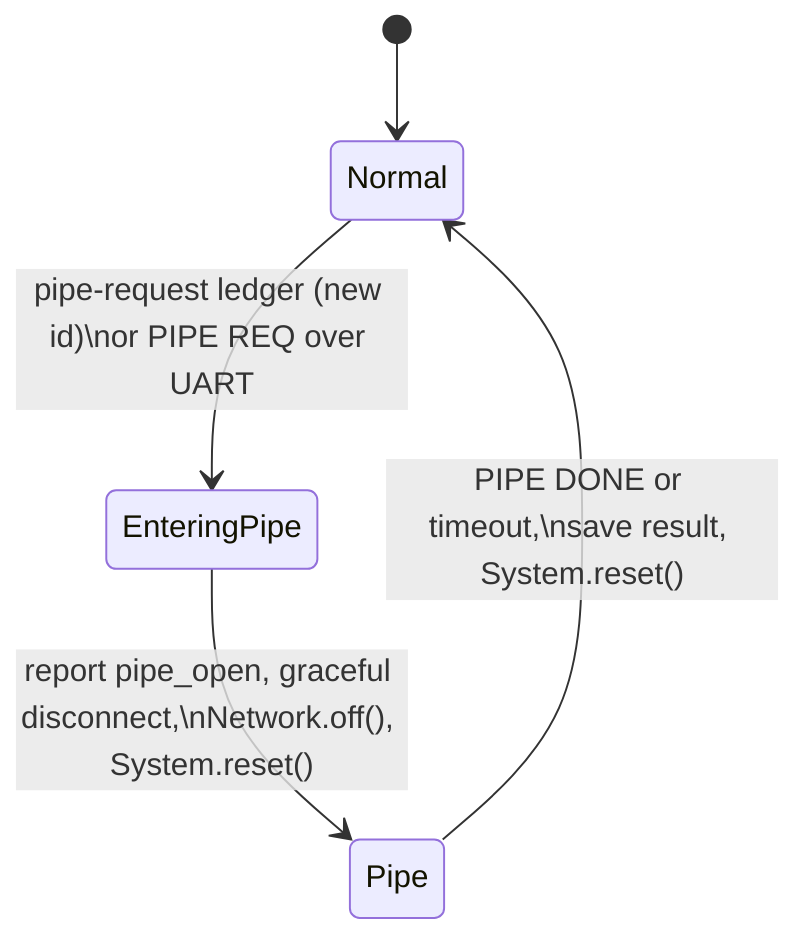

# B504e USB Direct Mode

On-demand USB Direct Mode for the Particle B504e: firmware and host tooling that let a B504e and a Linux host (tested with a Digi ConnectCore 93) share one cellular modem:

- **Normal mode (primary path):** the B504e stays connected to the Particle cloud and publishes telemetry the host sends it over UART.
- **Pipe mode (on demand):** when the host needs a large download, such as a system update, the B504e goes offline and hands its cellular modem to the host over USB. When the host is done, the B504e reconnects and reports the result.

A pipe can be requested by the cloud (through a Particle Ledger) or by the host itself (over UART). The B504e coordinates every handoff, because Device OS owns the modem. The host owns the download.

## Results

Measured on the bench with a B504e (LTE Cat 1, Quectel EG91) and a ConnectCore 93 running stock Digi Embedded Yocto 5.0:

| Test | Trigger | Result |
|---|---|---|
| 200 MB download | Edge (button on the host) | 218 s, 7.7 Mbps |
| 200 MB download | Cloud (Ledger) | 290 s, 5.8 Mbps |
| 100 MB download | Cloud and edge | 143 to 144 s, 5.8 to 5.9 Mbps |

For comparison, the same 200 MB over the B504e's UART would take about 38 minutes even at 921600 baud (theoretical best case, ~92 KB/s), so USB is roughly 8 to 10 times faster. Cellular throughput varies with signal and network load.

Overhead per pipe, on top of the download itself:

- **Request to modem handed over:** about 1.5 to 2 minutes (graceful disconnect, reset, modem switch, settle time).
- **Done to cloud reconnected:** about 25 seconds, with the host restoring the modem's default mode at the end of the pipe (about 95 seconds if the B504e has to do it on its next boot).

For a 1 MB pipe, that's about 2 minutes 20 seconds from button press to back online.

## How it works



**Normal mode:** the B504e connects exactly like a stock device, sending the modem no commands of its own, unless a pipe ended without the host restoring the modem; then it restores the modem's default mode first and resets, so it still connects from a clean boot. It relays telemetry and reports the last pipe's result in the `pipe-status` Ledger.

**Entering a pipe:** the B504e reports `pipe_open` to the cloud (and waits for confirmation), disconnects gracefully, saves the request in retained memory, and resets.

**Pipe mode:** the B504e never connects. It switches the modem to ECM mode (which gives the host a `usb0` network interface with its own data session), waits for it to settle, and sends `PIPE READY` to the host. When the download is done, the host puts the modem back in its default USB mode over the modem's own AT port and reboots it, then sends `PIPE DONE`. The B504e saves the result and does a single reset into an ordinary normal boot. If the host couldn't restore the modem (or the pipe timed out), the next boot restores it instead.

Switching modes with `System.reset()` means every transition starts from a clean boot. The firmware sends the modem AT commands only in pipe mode, and in normal mode only to clean up after a pipe the host didn't close normally, never during an ordinary normal boot: sending them while Device OS is setting up the modem was found to derail it. If a pipe ends uncleanly (a crash, a watchdog reset, or a reset while closing), a flag in retained memory tells the next normal boot to restore the modem's default mode and reset before connecting. If retained memory is lost too (power loss mid-pipe), a normal boot that can't connect within 3 minutes checks the modem's mode and fixes it, and one that stays offline for 10 minutes resets.

### Why the modem's USB mode changes

| Modem USB mode | Device OS | Host |
|---|---|---|
| Default (`AT+QCFG="usbnet",0`) | Connects normally | Serial ports only. The data interface is QMI, which needs the `qmi_wwan` driver (not in the stock DEY kernel). |
| ECM (`AT+QCFG="usbnet",1`) | **Cannot connect**: the modem starts its own data session, and Device OS's dial fails | Gets a `usb0` network interface (standard `cdc_ether` driver), with DHCP and a working data session |

Neither mode works for both sides at once, so the B504e uses ECM only during pipes. This works with the stock DEY kernel, with no host kernel changes.

## Repository layout

```
firmware/
  project.properties     Particle project file
  src/main.cpp           B504e firmware
host/
  pipe_client.sh         Host-side pipe client (UART + download + SW5 button)
  89-eg91-deauthorize.rules  udev rule: keep the modem's USB deauthorized by default
  90-eg91-ecm.rules      udev rule: start DHCP when the modem's usb0 appears
  eg91-dhcp@.service     systemd service: DHCP client for usb0
docs/
  BRINGUP.md             Step-by-step setup, from boxed hardware to a working pipe
  PROTOCOL.md            UART protocol, Ledger schemas, configuration
  TESTING.md             Test scenarios, results, findings, and limitations
  PARTICLE_NOTES.md      Modem and Device OS behaviors found during testing
LICENSE                  BSD 3-Clause
```

## Quick start

The full procedure is in [docs/BRINGUP.md](docs/BRINGUP.md). In short:

1. **Prerequisite:** the CC93 running Digi Embedded Yocto 5.0 (see Digi's documentation), and the B504e in a Particle product.
2. **Wire it up:** the breakout's cellular modem USB-C port to a host USB port, and the B504e's UART (TX, RX, GND) to the host's UART. **Always power the breakout first and the host last** (see [the power-up order](docs/BRINGUP.md#power-up-order)).
3. **Host:** disable ModemManager, install the two udev rules and the DHCP service, and copy `pipe_client.sh`.
4. **Cloud:** create the `pipe-request` (cloud to device) and `pipe-status` (device to cloud) Ledgers, and the `PIPE_MAX_MINUTES`, `PIPE_SETTLE_S`, and `UART_BAUD` environment variables.
5. **B504e:** build `firmware/` for the `b5som` platform on Device OS 6.4.1 and flash it.
6. **Run:** start `pipe_client.sh` on the host, then create the device's `pipe-request` instance with `id` = `test-001` and `reason` = `bench-test` (or press the button on the host).

## Requirements

**B504e side**

- Particle B504e on the M.2 SoM breakout board, powered from its own supply
- Device OS 6.4.0 or later (tested on 6.4.1)
- The device in a Particle product, for environment variables

**Host side**

- Digi Embedded Yocto 5.0 on the ConnectCore 93 (installation not covered here; see Digi's documentation)
- `cdc_ether` kernel driver (present in stock DEY 5.0)
- A UART to the B504e
- A way to run DHCP on `usb0` when it appears (the provided udev rule and systemd service)
- **The modem's USB deauthorized outside pipes** (the provided udev rule; `pipe_client.sh` authorizes it only during a pipe). While a host has the modem's USB configured, the modem stops answering Device OS reliably: the B504e loses contact with it a few minutes into a session.
- **ModemManager disabled.** With it running, Device OS completes its cloud handshake but never finishes connecting.
- For `pipe_client.sh`: BusyBox `sh`, `stty`, `wget`, `awk`, `ip`, and libgpiod's `gpiomon` for the button

## Documentation

- [docs/BRINGUP.md](docs/BRINGUP.md): hardware, wiring, Mac and host setup, cloud setup, flashing, first pipe, troubleshooting
- [docs/PROTOCOL.md](docs/PROTOCOL.md): the UART protocol, Ledger schemas, environment variables, and timing
- [docs/TESTING.md](docs/TESTING.md): test scenarios, expected output, recorded results, findings, and known limitations
- [docs/PARTICLE_NOTES.md](docs/PARTICLE_NOTES.md): modem and Device OS behaviors found during testing, with evidence

## Status

A proof of concept, validated on the bench (B504e on Device OS 6.4.1, ConnectCore 93 on stock DEY 5.0-r3). Every planned test passed on the final firmware, client script, and udev rules:

- Cloud-triggered and button-triggered pipes, 1 MB to 200 MB, closing with the host restoring the modem and the B504e back online in ~25 s
- Telemetry relay over UART with typed data
- Duplicate cloud requests ignored; a request interrupted by an OTA reset picked up again
- Timeout, B504e reset mid-pipe, and power loss mid-pipe, all recovering without manual steps
- Host reboots, B504e restarts and OTA updates with the host running, and all three power-up orders

Not yet verified: the hardware watchdog actually firing, and UART baud rates above 115200.

See [docs/TESTING.md](docs/TESTING.md) for the results, the findings behind the design, and the known limitations.

## Future improvements

- **A library with a stable API.** Package the pipe logic as a Particle library with an explicit state machine inside, and hooks for applications: handling telemetry (event names, filtering, aggregation), custom UART commands, vetoing a pipe (for example, only when docked), and actions before and after a pipe.
- **Richer telemetry publishing.** Use Device OS's newer event support for larger structured payloads, and queue readings (including through a pipe) instead of answering `ERR busy`.
- **A protocol version.** Report it at boot and on request, so hosts and firmware can evolve independently.
- **Shorter handover.** Lower `PIPE_SETTLE_S` once the modem's data-session timing in ECM mode is characterized.
- **Data while Device OS stays connected.** With `qmi_wwan` in the host kernel, the modem could stay in its default mode and the host could use a separate PDP context, removing the mode switching (and possibly the offline window) altogether. Needs a custom host kernel and testing of concurrent use.
- **Upstream fixes.** Several workarounds here (the deauthorize rule, the host-side modem reboot) cover modem and Device OS behaviors described in [docs/PARTICLE_NOTES.md](docs/PARTICLE_NOTES.md). If Particle addresses them, the design could get simpler.

## License

BSD 3-Clause. See [LICENSE](LICENSE).
